<p align="center">
  
</p>

<h1 align="center">Windfall</h1>

<p align="center"><i>Snow, leaves, petals and rain come down; flowers grow where they land.</i></p>

<p align="center">
  <a href="https://github.com/tak0dan/windfall/releases/latest/download/Windfall-Setup.exe"></a>
  <a href="https://github.com/tak0dan/windfall/releases/latest/download/Windfall-portable.exe"></a>
  <a href="https://aur.archlinux.org/packages/windfall"></a>
</p>

<p align="center">
  <a href="https://github.com/tak0dan/windfall/releases/latest"></a>
  
  
</p>

Windfall is a weather overlay for your desktop. Weather, sparkles or a garden are drawn over everything you do; it
settles on the tops of your windows and on the taskbar or your bars, reacts to your cursor, and never gets in the
way: the overlay is click-through, light, and pauses behind fullscreen apps. It is written from scratch in Rust for
**Hyprland** (Wayland) and **Windows 10/11**, inspired by the macOS app *Snowhush* (no code from it is used).

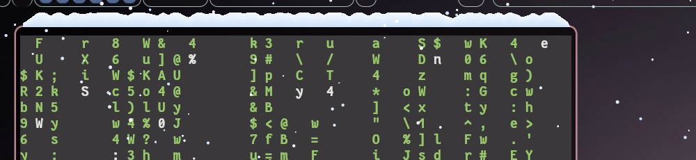

---

## Contents

[Effects](#effects) · [Flower elements](#flower-elements) · [Two looks: smooth and pixel art](#two-looks-smooth-and-pixel-art) ·
[Controller and tray](#controller-and-tray) · [Install](#install) · [Use](#use) · [How it behaves](#how-it-behaves) · [Build](#build-it-yourself) · [Licence](#licence)

## Effects

Eight effects. Pick one in the controller, from the tray menu, or with `windfallctl effect <name>`.

### Weather that piles up

Snow, autumn leaves and cherry blossom fall and **settle** on the top edge of every window (following its rounded
corners), on bars and panels, and on the bottom of the screen. Push the cursor through a drift and it parts and
sprays; the snow you push is the snow that lands elsewhere, nothing is created. Move or drag a window and its pile
slides off gradually; close it and the pile drops. With *Melt* on, piles thaw slowly so they never take over.

| | |
|---|---|
|  **Snow** | 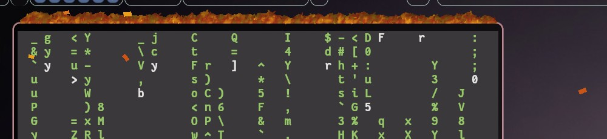 **Autumn leaves**: heaps are made of individual leaves, mottled in colour |
| 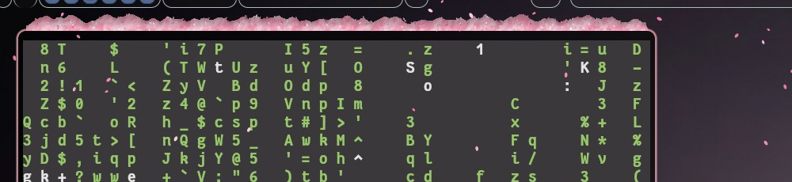 **Cherry blossom** | 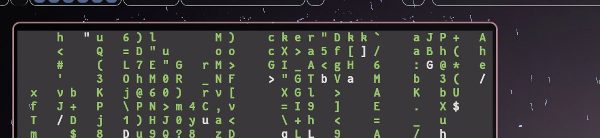 **Rain** splashes where it lands and does not pile up |

### A garden

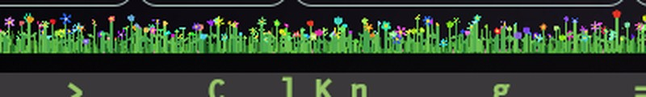

**Flowers** grow instead of falling: a thick, bushy lawn of grass with tiny flowers of mixed sizes and shapes along
the same edges. Brush the cursor over them and they sway, stretch up while you stay, glow where you play with them
and settle back afterwards. Now and then a flower bursts into a few sparks and a different one grows in its place.
The lawn follows its window: stretch the window and the lawn stretches with it, corners staying in their corners,
gaps filled on the spot. On a rounded corner the flowers grow up to three quarters of the way round the curve and
the grass further, rooted on the curve itself.

### Particles

| | |
|---|---|
| 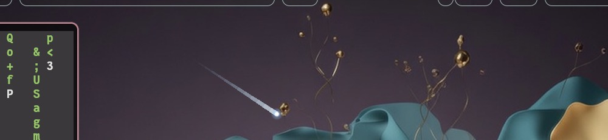 **Shooting stars** burst into blue sparks on whatever they hit | 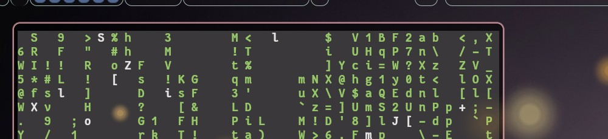 **Warm lights**: slow, glowing, anime-style circles of light |
| 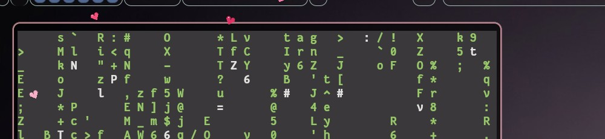 **Falling hearts** pop into pink sparks | |

## Flower elements

The flowers can be made of something other than nature (`windfallctl element <name>`). Each has its own flowers,
grass, things drifting off it, and **its own glow** when you touch it.


**Natural** — every colour; touching them gives a soft golden parabola of light standing on the plants.

| Element | Flowers | Touched |
|---|---|---|
| **Lightning** — Genshin-style Electro: electric-violet pointed stars with a white-lilac core, now and then a short jagged arc | 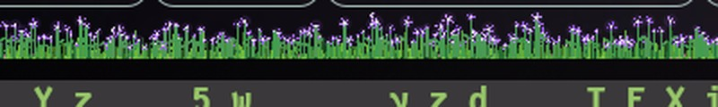 | 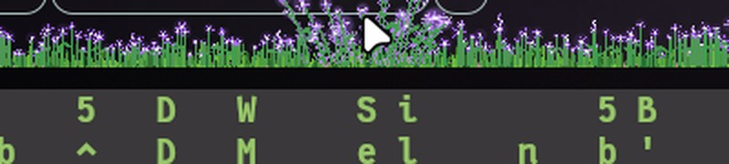 |
| **Fire** — tulips from yellow through orange to red; the top quarter of each stem is burnt | 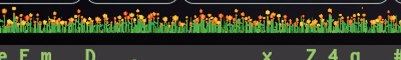 | 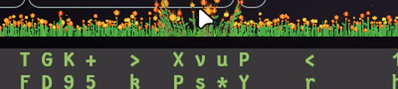 |
| **Ice** — frosted crystal stars on pale grass, twinkling glints | 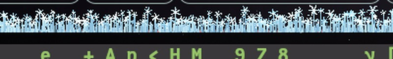 | 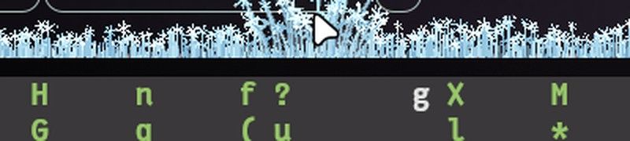 |
| **Matter** — gold and bronze cogs with dust orbiting them | 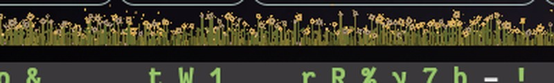 | 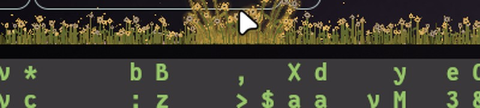 |
| **Void** — dark indigo flowers with black hearts; touched, they cast a dark halo with a bright rim | 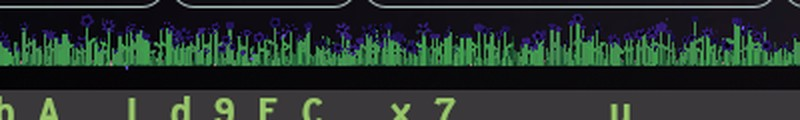 | 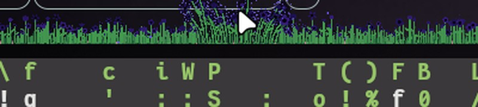 |

(Natural, for comparison: 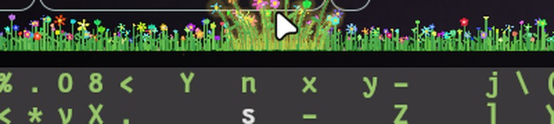)

The glow colour can also be picked yourself: `windfallctl glow "#ff66aa"`, or the colour button in the controller.

## Two looks: smooth and pixel art

*Smooth* is soft and anti-aliased. *Pixel art* draws on a coarse grid with a limited palette and hard edges; the
pixel size (1–10) and the number of colours are adjustable, and **the controller restyles itself to match**.

| Smooth | Pixel art |
|---|---|
|  | 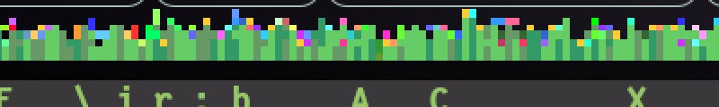 |
|  | 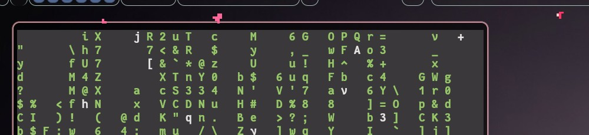 |
|  | 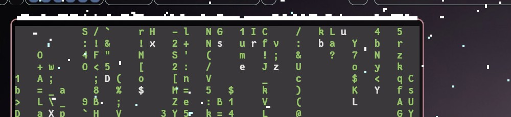 |
|  | 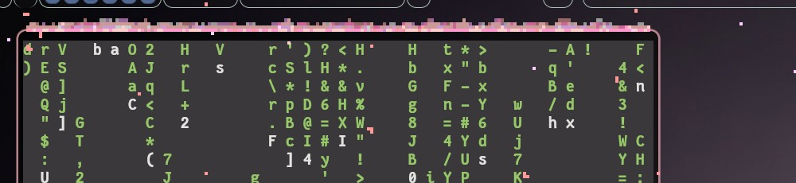 |

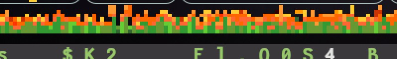

## Controller and tray

A tray icon (a little drawing of the current effect) sits in your bar's tray. **Left-click** opens the controller,
**middle-click** shows/hides the effect, **right-click** has the menu: Display, effect, flower element, renderer,
intensity, Clear, Quit.

The controller has a live preview, every setting, and **takes its colours from the running effect**: icy blue for
snow, amber for leaves, rose for hearts, and so on. In pixel-art mode the controller itself turns pixel-art.

| Snow | Flowers (fire) | Hearts, pixel art |
|---|---|---|
| 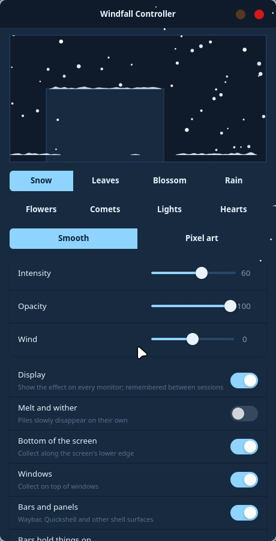 | 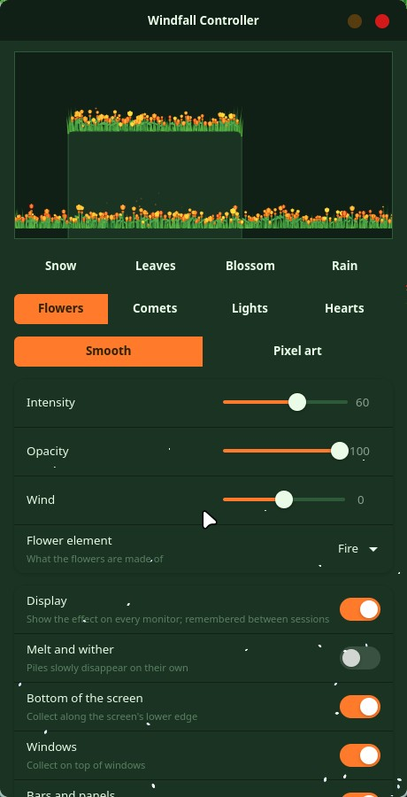 | 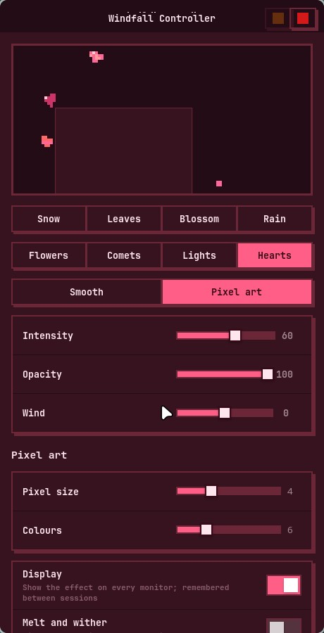 |

The **Display** switch is remembered between sessions, and on Linux the package starts Windfall with your Hyprland
session.

## Install

### Windows 10 / 11

<p>
  <a href="https://github.com/tak0dan/windfall/releases/latest/download/Windfall-Setup.exe"></a>
  <a href="https://github.com/tak0dan/windfall/releases/latest/download/Windfall-portable.exe"></a>
</p>

* **Installer (`Windfall-Setup.exe`)** installs for the current user, no administrator rights needed, starts with Windows,
  adds Start-menu shortcuts (Windfall, Windfall Controller) and an uninstaller in *Settings → Apps*.
* **Portable (`Windfall-portable.exe`)** is a single file: put it anywhere and run it; a tray icon appears.
  The tray menu has *Start with Windows* if you want it at login.
* Click the tray icon for the controller (a small page shown in an Edge app window); right-click for the menu.

  
* Settings live in `%APPDATA%\windfall\config.toml`; logs in `%LOCALAPPDATA%\windfall`.

Windows shows a SmartScreen warning for programs it has not seen before; choose *More info → Run anyway*.
Tested on Windows 11. On Windows, the top edges of windows and of the taskbar collect things (there are no bars or
panels to detect), and fullscreen apps pause the overlay unless *Over fullscreen* is on.

### Arch Linux (Hyprland)

```sh
yay -S windfall            # or: paru -S windfall
```

Or build it from this repository:

```sh
git clone https://github.com/tak0dan/windfall && cd windfall/packaging
makepkg -si
```

The package installs `windfalld` (the overlay), `windfallctl`, `windfall-gui` (the controller), a desktop entry
(**Windfall Controller**), the icon and a systemd user unit, and **starts with your Hyprland session** (it enables the
user unit globally and adds an XDG autostart entry). Start it right away with `windfalld &`. If your session does not
start systemd user units or XDG autostart, add one line to your Hyprland config:

```
exec-once = windfalld                     # hyprland.conf
hl.exec_cmd("windfalld")                  -- hyprland.lua
```

Needs Hyprland (or another compositor with `wlr-layer-shell` and `wlr-screencopy`), OpenGL ES (Mesa), GTK4 and libadwaita.

## Use

```sh
windfallctl status                    # what is running
windfallctl on | off | toggle         # show / hide (remembered between sessions)
windfallctl effect flowers            # snow leaves blossom rain flowers comets lights hearts
windfallctl element fire              # natural lightning fire ice matter void
windfallctl renderer pixel            # smooth | pixel
windfallctl intensity 70              # 0-100
windfallctl pixel-size 2              # 1-10
windfallctl glow "#c08bff"            # colour of the flowers' glow
windfallctl bars visible              # Linux: grow on a bar's painted parts only, or `whole`
windfallctl clear                     # sweep everything away
```

The same commands work with `windfallctl.exe` on Windows (installer only). Settings are in
`~/.config/windfall/config.toml` (Linux) or `%APPDATA%\windfall\config.toml` (Windows).

## How it behaves

* **Windows and workspaces.** Snow on a window waits, unseen, while its workspace is off screen and is there when it
  returns. Windows hidden behind other windows never collect anything.
* **Transparent bars (Linux).** Waybar or Quickshell bars whose modules are framed pills over a transparent strip only
  hold things on the *painted* parts: Windfall looks at the screen (wlr-screencopy) once a second to find them. A
  module that resizes keeps its lawn, which stretches or squeezes with it; a module that disappears loses it in a
  quick wave of blue puffs. Choose `windfallctl bars whole` to use the bar's whole rectangle instead.
* **Light.** About a core's worth of CPU at most; no polling when disabled; pauses behind fullscreen windows.
* **Screenshots.** The overlay is part of the picture on both platforms.
* **Linux details.** Window geometry comes from Hyprland's IPC; fractional scaling is supported; the overlay is a
  click-through `wlr-layer-shell` surface drawn with OpenGL ES. **Windows details.** A per-pixel-alpha click-through
  layered window per monitor, drawn by a small software rasterizer; per-monitor DPI aware.

## Build it yourself

```sh
cargo build --release          # Linux: target/release/{windfalld,windfallctl,windfall-gui}
cargo test -p windfall-core    # the simulation is fully unit-tested
windows/build.sh               # Windows: dist/Windfall-Setup.exe, dist/windfalld.exe (cross-compiled, Docker only)
```

The simulation (`crates/core`) knows nothing about Wayland or Windows: it turns a scene (window rectangles, bars, the
cursor) into a list of coloured shapes. `crates/daemon` has the Hyprland and Windows backends, `crates/ctl` the
command-line tool and `crates/gui` the GTK4 controller (Linux). `windfall-gui --render out.png flowers fire smooth 24`
draws a picture of an effect without a display.

## Licence

GPL-3.0-or-later. An independent implementation inspired by the macOS app Snowhush; no code from it is used.
