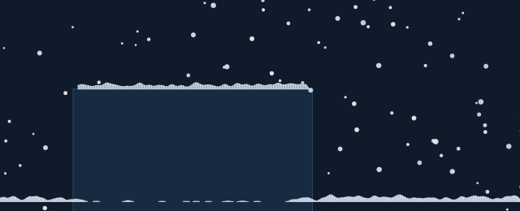
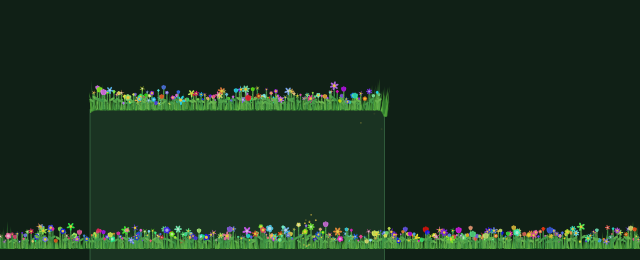
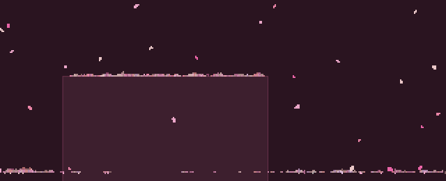
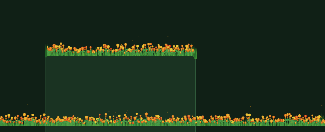
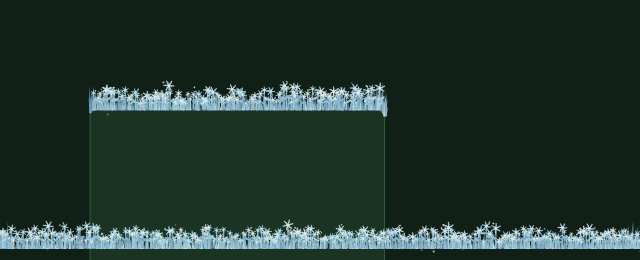
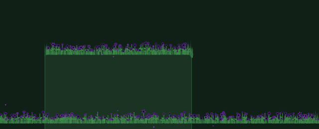
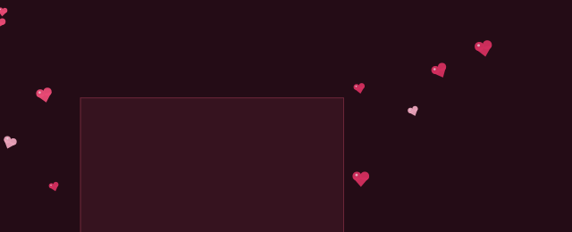
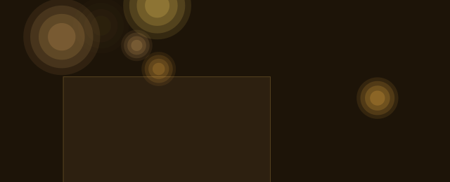
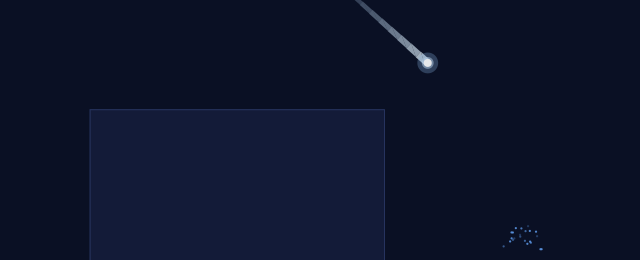
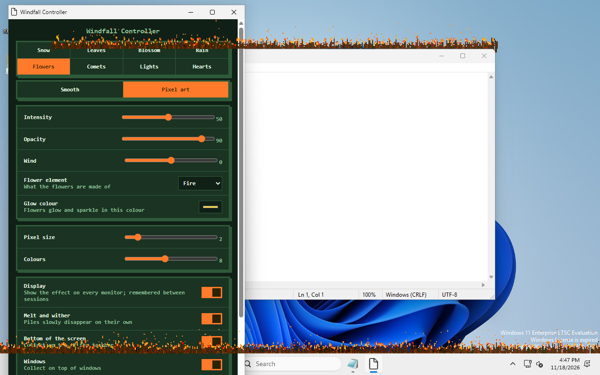

# Windfall

*Snow, leaves, petals and rain come down; flowers grow where they land.*

A weather overlay for your Hyprland desktop. Written from scratch in Rust for Wayland, inspired by the macOS
app Snowhush (no code from it is used).

* **Effects** – snow, leaves, blossom and rain fall and pile up on window tops, bars and the screen's edge.
  Flowers instead grow in a thick lawn of tiny blooms along the same edges; they sway when the cursor
  brushes them and stretch up while it stays, then settle back.
* **Flower elements** – the flowers can be made of *lightning*, *fire*, *ice*, *matter* or *void*, each with its own
  shapes, grass, glow and things drifting off it (`windfallctl element fire`).
* **Particle modes** – *shooting stars* that burst into blue sparks on whatever they hit, slow *warm lights*
  (anime-style bokeh circles) and *falling hearts* that pop into pink sparks.
* **Display switch** – show/hide everything from the tray, the controller or `windfallctl on|off`; the choice is
  remembered between sessions. The package starts Windfall with your Hyprland session.
* **Two renderers** – *smooth* (soft, anti-aliased) and *pixel art* (coarse grid, limited palette, hard edges;
  pixel size and colour count are adjustable). The controller restyles itself to match.
* **Tray icon** (StatusNotifier) – left click opens the controller, middle click toggles, right click has the menu.
* **Controller** (GTK4 + libadwaita) – live preview, themed after the running effect.
* **Bars** – transparent bars (Waybar modules with frames, Quickshell pills…) only hold things on the parts
  that are actually painted. Windfall looks at the screen (wlr-screencopy) to find them, and re-checks every
  second. Choose *Whole bar* in the controller (or `windfallctl bars whole`) to disable that.
* **Hyprland** – window geometry, workspaces, fullscreen, rounded corners and borders come from Hyprland's IPC.
  Snow on a window waits while its workspace is off screen, slides off gradually when the window is moved, and
  drops when it closes. Clicks pass straight through the overlay. Fractional scaling is supported.

| | | |
|---|---|---|
|  |  |  |
|  |  |  |
|  |  |  |

## Install

Arch / AUR:

```sh
git clone https://github.com/tak0dan/windfall && cd windfall/packaging
makepkg -si            # or from the AUR: yay -S windfall
```

This installs `windfalld`, `windfallctl`, `windfall-gui`, a system-wide desktop entry
(**Windfall Controller**), the icon and a systemd user unit.

Start it with your session. Either

```sh
systemctl --user enable --now windfalld      # needs a systemd-aware Hyprland session (e.g. uwsm)
```

or in `hyprland.conf`: `exec-once = windfalld` (Lua config: `hl.exec_cmd("windfalld")`).

### Windows 10 / 11

Download `Windfall-Setup.exe` from the [Releases](https://github.com/tak0dan/windfall/releases) page. It installs for
the current user (no administrator rights), starts with Windows and puts a tray icon in the notification area:
click it for the controller, right-click for the menu. The controller is a small page served on `127.0.0.1` and shown
in an Edge app window; `windfallctl.exe` works exactly like on Linux. Settings are in `%APPDATA%\windfall\config.toml`.

Windows differences: windows' top edges and the taskbar's top edge collect things (there are no bars/panels to
detect), the overlay is a click-through layered window, and fullscreen apps pause it unless "Over fullscreen" is on.


Tested on Windows 11 (LTSC 24H2). To build it yourself, run `windows/build.sh` (Docker only; it produces `dist/Windfall-Setup.exe`).

## Use

```sh
windfallctl effect flowers
windfallctl renderer pixel
windfallctl intensity 70
windfallctl bars visible|whole
windfallctl status --json
```

Settings live in `~/.config/windfall/config.toml`. The control socket is `$XDG_RUNTIME_DIR/windfall.sock`
(one JSON request per line; see `crates/core/src/ipc.rs`).

## Notes

* The overlay lives on the compositor's overlay layer, so screenshots and screen sharing include it.
* Needs `wlr-layer-shell` and `wlr-screencopy` (Hyprland has both) and OpenGL ES (Mesa).
* Rotated monitors and mirrored outputs are not handled specially yet.

## Licence

GPL-3.0-or-later. Independent implementation, inspired by the macOS app Snowhush; no code from it is used.
